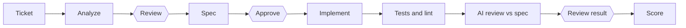

# Tesserax

Workflows that put a human gate between AI agents and your code.

## Core loop



Each ticket runs through a workflow: a graph of steps stored as a JSON file you can edit. AI steps write documents, an agent implements in a git worktree on its own branch, and checks run on the result. Diamonds are human gates: you edit, approve, send back with feedback, or reject. Nothing is pushed or merged for you.

Local mode: one backend process, bound to 127.0.0.1, no login.

## Requirements

- Node 22+ and pnpm 10 (`corepack enable`)
- Docker (Postgres 16)
- Optional: the `claude` CLI, signed in, to run AI steps and agents

## Quick start

```bash
git clone <repo-url> tesserax && cd tesserax
corepack enable
cp .env.example .env
pnpm install
pnpm dev
```

- Web: http://127.0.0.1:5180
- API: http://127.0.0.1:4400 (health: http://127.0.0.1:4400/health)

`pnpm dev` starts Postgres in Docker, migrates the database, creates `workflows/` and `skills/` from `examples/` on first run, then starts the API and the web app. Stop with Ctrl+C; `pnpm db:down` stops Postgres (data is kept in a Docker volume).

## Your first run

1. Open **Repos** and add a repository (its origin and base branch) and a workplace (a local checkout of it).
2. On **Tasks**, click **New task** and pick the repository. Or connect Jira to sync your issues ([integrations](docs/integrations.md)).
3. Click **Start workflow** on the task.
4. Open the run on **Runs**. At the first gate, read the analysis, edit it if you want, then approve it or send it back with feedback.

The later gates (spec, result) work the same way. When the run is done, score it. More in [docs/workflows.md](docs/workflows.md).

## Concepts

- **Workflow**: a graph of nodes in `workflows/<id>.workflow.json`. Edit it on the **Workflows** page. See [workflows](docs/workflows.md).
- **Node**: one step. Types include `ai.step`, `agent.run`, `check.command`, `ai.review`, `human.gate` and `evaluate`. See [node types](docs/workflows.md#node-types).
- **Skill**: a Markdown prompt in `skills/<name>/SKILL.md` that a node uses. Each node run records the skill's hash. See [writing a skill](CONTRIBUTING.md#writing-a-skill).
- **Gate**: a point where the run waits for you. See [gates](docs/workflows.md#gates-score-and-loops).
- **Agent**: the tool that implements the change: Claude Code, Gemini CLI, Antigravity CLI, or your IDE. It works in a worktree, commits locally and never pushes. See [agents](docs/agents.md).

## Configuration

Copy `.env.example` to `.env` (gitignored). The defaults work as they are; the keys below are optional.

| Key | What it does |
|---|---|
| `API_PORT`, `WEB_PORT` | Ports of the API (4400) and the web app (5180) |
| `DATABASE_URL` | Postgres connection (port 54329 by default) |
| `CLAUDE_BIN` | Path of the `claude` CLI (default `claude`) |
| `JIRA_BASE_URL`, `JIRA_EMAIL`, `JIRA_API_TOKEN`, `JIRA_JQL` | Sync Jira Cloud issues as tasks |
| `BITBUCKET_API_TOKEN`, `BITBUCKET_EMAIL` | Open and comment on Bitbucket pull requests |
| `TELEGRAM_BOT_TOKEN`, `TELEGRAM_ALLOWED_USER_IDS` | Read-only Telegram bot |
| `AUTO_START` | `workflow` (default) starts a run for new Jira issues, `off` disables it |

Setup for each integration is in [docs/integrations.md](docs/integrations.md).

## Roadmap

See [docs/roadmap.md](docs/roadmap.md).

## Contributing and security

- Want to help? Read [CONTRIBUTING.md](CONTRIBUTING.md).
- Agents run commands on your machine. Read [SECURITY.md](SECURITY.md) and report vulnerabilities as described there.

## License

Apache License 2.0, see [LICENSE](LICENSE).
